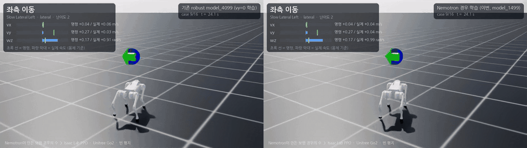
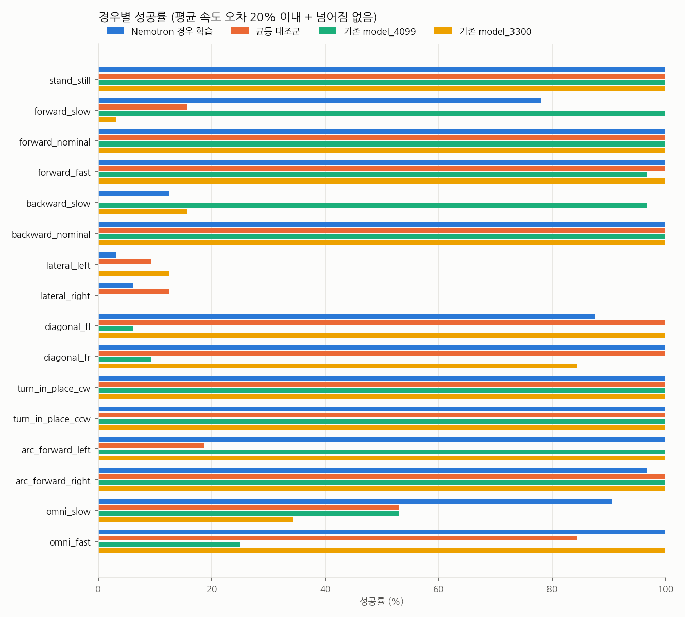

# nemotron-go2-rl

**NVIDIA Nemotron이 보행의 "경우의 수"를 설계하고, Isaac Lab PPO가 그것을 학습하고, Claude Code 플러그인이 전체 루프를 실행·보고하는 Unitree Go2 강화학습 프로젝트.**

*Nemotron designs the walking cases, a deterministic validator gates them, Isaac Lab PPO learns them
on an empty flat plane, and a Claude Code plugin runs and reports the loop. Stage 1: walking.*



```text
 Claude Code ── go2-walk-lab plugin (/go2-walk, /go2-walk-cases, /go2-walk-train)
      │                         nemotron-customize plugin (NVIDIA, Nemotron 학습 파이프라인)
      ▼
 1. Nemotron 3.5 Lightning (Ollama / NIM / build.nvidia.com, OpenAI 호환 API)
      │  JSON schema 구조화 출력: 보행 경우 16~24개 + 외란 범위
      ▼
 2. 검증기 (결정적 코드)
      │  Go2 안전 범위로 clamp · 분류별 조건 · 필수 분류 · 좌우 대칭 · 최소 외란
      │  문제 → Nemotron에 수정 요청 (repair loop) → 그래도 남으면 guard
      ▼  configs/cases/go2_walk_flat_v1.json
 3. Isaac Lab + RSL-RL PPO, 빈 평지에서 Go2 4096대
      │  경우별 가중 샘플링 + 난이도 커리큘럼 (1 → 2 → 3)
      ▼
 4. 경우별 평가 (같은 seed·같은 명령) → 5. 영상 → 6. 보고서
```

## 왜 이렇게 만들었나

평지 보행 정책은 "어떤 속도 명령을 얼마나 자주 연습시키느냐"에 따라 약점이 생긴다. 이전 연구실 정책은
`vy = 0`으로만 학습되어 옆걸음을 못 했고, 0.15 m/s 근처 저속에서 멈춰 섰다. 이 저장소는 그 명령 분포를
사람이 손으로 정하지 않고 **Nemotron이 경우의 수로 열거**하게 한 뒤, LLM 출력은 그대로 믿지 않고
**검증기가 안전 범위·대칭·커버리지를 강제**한다. 학습 결과는 경우별로 평가해서 어떤 경우가 아직 안 되는지 보인다.

## 구성

| 경로 | 내용 |
|---|---|
| `nemotron_go2_rl/cases/` | Nemotron 클라이언트(표준 라이브러리만), 프롬프트, 스키마·검증기, repair/guard 루프 |
| `nemotron_go2_rl/tasks/` | Isaac Lab 태스크: 경우 기반 속도 명령 term, 평지 환경, PPO 설정 |
| `scripts/generate_cases.py` | Nemotron → 검증된 카탈로그 JSON |
| `scripts/train.py` · `evaluate.py` · `record.py` · `report.py` | 학습 · 경우별 평가 · 영상 · 차트/표 |
| `configs/cases/` | Nemotron이 만든 카탈로그 (생성 모델, 프롬프트 해시, 시도 기록, 자동 수정 내역 포함) |
| `plugins/nemotron-go2-rl/` | Claude Code 플러그인 `go2-walk-lab` (스킬 3개) |
| `.claude-plugin/marketplace.json` | 이 저장소를 Claude Code 마켓플레이스로 노출 |
| `policies/stage1_walk/` | 1단계 결과 정책 (TorchScript, ONNX, 학습에 쓴 카탈로그, deploy.yaml) |
| `docs/stage1_walk.md` | 1단계 실험 기록 (설정, 결과, 한계) |

관측(actor 45 / critic 60)·행동(12)·보상은 [unitree_rl_lab](https://github.com/unitreerobotics/unitree_rl_lab)의
`Unitree-Go2-Velocity`와 동일하다. 그래서 학습된 정책은 기존 deploy/sim2sim 도구에 그대로 들어가고,
기존 체크포인트도 같은 경우들로 평가할 수 있다.

## 설치

필요한 것: NVIDIA GPU (RTX 3090 24 GB에서 검증), Isaac Sim 5.1 + Isaac Lab 2.3, unitree_rl_lab (Go2 asset과 보상 함수),
Nemotron 엔드포인트 하나.

```bash
# 1) Isaac Lab 2.3 환경에 unitree_rl_lab 설치 (그 저장소 README 참고)
conda activate isaac-sim            # Isaac Lab이 설치된 환경 이름
# 2) 이 저장소 (설치 없이 scripts/가 경로를 잡는다. 패키지로 쓰려면 pip install -e .)
git clone <this repo> && cd nemotron-go2-rl
# 3) Nemotron (로컬)
ollama pull nemotron-3.5-lightning:30b   # 25 GB. 작은 대안: nemotron-3-nano:4b
```

## 실행

```bash
# 1. Nemotron으로 경우의 수 생성 (Ollama 기본; 다른 엔드포인트는 --base-url/--model/--api-key-env)
python scripts/generate_cases.py

# 2. 학습 (Isaac Lab 환경, headless, RTX 3090 기준 1500 iteration 약 30분)
python scripts/train.py --headless --max_iterations 1500 --run_name nemotron_cases_v1
#    대조군: 같은 설정, 명령만 전체 범위 균등
python scripts/train.py --headless --task Nemotron-Go2-Walk-Flat-Uniform --max_iterations 1500 --run_name uniform_v1

# 3. 경우별 평가 (여러 체크포인트를 같은 seed·같은 명령으로)
python scripts/evaluate.py --headless --policy ours=<run>/model_1499.pt --policy uniform=<run>/model_1499.pt \
    --out outputs/eval/stage1.json

# 4. 영상: 한 대가 모든 경우를 차례로 수행, 카메라가 따라감
python scripts/record.py --headless --policy "ours=<run>/model_1499.pt" --out outputs/videos/ours.mp4

# 5. 차트와 표
python scripts/report.py --eval outputs/eval/stage1.json --run ours=<run> --run uniform=<run> --out docs/results
```

Isaac Sim 캐시 위치를 바꿔야 하는 환경이면 각 명령 뒤에 `--kit_args="--portable-root <dir>"`를 붙인다.

## Claude Code에서 쓰기

```text
/plugin marketplace add <this repo or local path>
/plugin install go2-walk-lab@nemotron-go2-rl
/plugin marketplace add NVIDIA-NeMo/Nemotron            # 선택: Nemotron 쪽 학습 파이프라인
/plugin install nemotron-customize@nvidia-nemotron
```

저장소 루트에서 Claude Code를 열면 `.claude/settings.json`이 두 플러그인을 켠다.

- `/go2-walk` — 1단계 전체: 환경 점검 → 경우 생성·검토 → 학습 → 평가 → 영상 → 보고서
- `/go2-walk-cases` — Nemotron 카탈로그 생성·수정, 검증기 규칙 설명
- `/go2-walk-train` — 학습·대조군·평가·녹화·리포트 명령

`nemotron-customize`는 이후 단계에서 채택된 카탈로그로 "경우 설계용" Nemotron을 SFT/RL로 미세조정할 때 쓰는 경로다.
1단계 실행에는 필요 없다.

## 결과 (1단계: 빈 평지 걷기)

Nemotron 3.5 Lightning이 16개 경우를 만들었고(검증기 수정 요청 2회 후 통과), Go2 4096대가 1500 iteration(약 25분, RTX 3090) 학습했다.
16개 경우 × 32대를 같은 seed·같은 명령으로 평가했다. 성공 기준은 넘어지지 않고 축별 평균 속도가 명령의 20 % 이내인 것이다.

| 정책 | 경우 평균 성공률 | 넘어짐 |
|---|---|---|
| **Nemotron 경우 학습** (이번) | **79.7 %** | 0 % |
| 균등 대조군 (같은 PPO·같은 1500회, 명령만 안전 범위 전체 균등) | 68.4 % | 0 % |
| 기존 unitree_rl_lab model_4099 (robust, `vy=0` 학습) | 68.0 % | 0 % |
| 기존 unitree_rl_lab model_3300 (원본 평지) | 71.9 % | 0 % |

- 명령 분포만 바꿔도 대조군보다 +11.3 %p 높았다. 저속 전진은 78 % vs 16 %, 저속 전방위는 91 % vs 53 %.
- 기존 4099가 못 하던 대각선·전방위 보행을 한다.
- **아직 안 되는 것**: 저속 옆걸음(명령 0.20 → 실제 0.13 m/s, 성공 3–6 %)과 저속 후진(12 %). 보상 함수가 저속 오차를 거의 벌하지 않는 것이 원인으로 보이며, 다음 단계에서 다룬다.

영상: [4개 정책 2×2 비교](docs/media/stage1_compare_4policies.mp4) ·
[16개 경우 투어](docs/media/stage1_tour_nemotron_cases.mp4) · [학습 과정 iteration 100→1499](docs/media/stage1_training_progress.mp4)



자세한 설정·수치·한계는 [docs/stage1_walk.md](docs/stage1_walk.md).

## 한계

- 평지만 다룬다. 경사·계단·장애물은 다음 단계다.
- 성공 판정은 시뮬레이션 안의 평균 속도 추종(20 %)과 넘어짐 여부다. 실기·MuJoCo sim2sim 검증은 하지 않았다.
- Nemotron 출력은 seed를 고정해도 서버·양자화에 따라 달라질 수 있다. 그래서 학습에 쓴 카탈로그를 그대로 커밋하고, 학습 로그(`params/cases.json`)에도 복사한다.

## 라이선스

Apache-2.0 ([LICENSE](LICENSE), [NOTICE](NOTICE)). Isaac Lab(BSD-3), unitree_rl_lab(Apache-2.0), RSL-RL(BSD-3),
NVIDIA Nemotron 저장소(Apache-2.0)는 각자의 라이선스를 따른다. Nemotron 모델 가중치는 이 저장소에 포함하지 않으며
NVIDIA Open Model License로 별도 배포된다.
