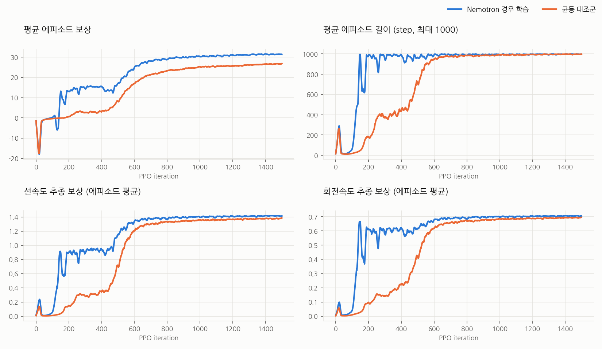
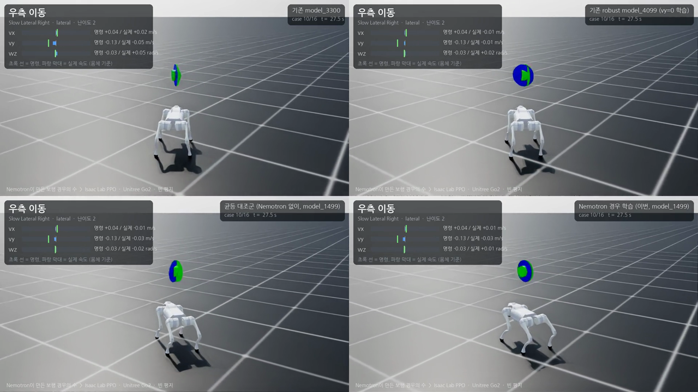

# 1단계: 빈 평지에서 걷기

기준일: 2026-10-29 · 장비: RTX 3090 24 GB · Isaac Sim 5.1 / Isaac Lab 2.3 / RSL-RL 3.0.1 · Nemotron 3.5 Lightning 30B-A3B (Ollama, Q4_K_M)

## 1. 목표

장애물·지형이 없는 무한 평지에서 Unitree Go2가 몸체 기준 속도 명령 `[vx, vy, wz]`를 따라 걷게 한다.
어떤 명령을 연습시킬지(= 걷기의 경우의 수)는 Nemotron이 정하고, 검증기가 그 결과를 안전 범위와 커버리지 규칙으로 걸러낸다.

## 2. Nemotron이 만든 경우의 수

`scripts/generate_cases.py` → `configs/cases/go2_walk_flat_v1.json`

Nemotron에게 준 정보: Go2 제원, 빈 평지라는 조건, 정책 입출력, 안전 범위, 분류 규칙, 이전 연구실 정책의 약점
(`configs/prompts/baseline_findings.txt`: 0.15 m/s 이하 정지, 저속 옆걸음 불안정, `vy=0`으로만 학습, 저속 회전 추종 부족).
JSON schema 구조화 출력으로 받는다.

### 최종 카탈로그 (16개, 모두 Nemotron 작성, guard 개입 없음)

| id | 한글 이름 | 분류 | 난이도 | 가중치 | vx (m/s) | vy (m/s) | wz (rad/s) | 유지 시간 (s) |
|---|---|---|---|---|---|---|---|---|
| stand_still | 서기 | stand | 1 | 0.093 | 0 | 0 | 0 | 1–5 |
| forward_slow | 천천히 전진 | forward | 1 | 0.069 | 0.1–0.3 | ±0.05 | ±0.1 | 2–4 |
| forward_nominal | 일반 전진 | forward | 1 | 0.069 | 0.5–0.8 | ±0.1 | ±0.1 | 3–5 |
| forward_fast | 빠른 전진 | forward | 2 | 0.046 | 0.9–1.0 | ±0.1 | ±0.1 | 3–6 |
| backward_slow | 천천히 후진 | backward | 1 | 0.069 | −0.3–−0.1 | ±0.05 | ±0.1 | 2–4 |
| backward_nominal | 일반 후진 | backward | 1 | 0.069 | −0.8–−0.5 | ±0.1 | ±0.1 | 3–5 |
| lateral_left | 좌측 이동 | lateral | 2 | 0.069 | ±0.05 | 0.1–0.3 | 0–0.2 | 1.5–3 |
| lateral_right | 우측 이동 | lateral | 2 | 0.069 | ±0.05 | −0.3–−0.1 | −0.2–0 | 1.5–3 |
| diagonal_fl | 왼쪽 대각 | diagonal | 2 | 0.056 | 0.2–0.4 | 0.1–0.3 | ±0.2 | 2–4 |
| diagonal_fr | 오른쪽 대각 | diagonal | 2 | 0.056 | 0.2–0.4 | −0.3–−0.1 | ±0.2 | 2–4 |
| turn_in_place_cw | 시계 회전 | turn_in_place | 2 | 0.069 | ±0.05 | ±0.05 | −1.2–−0.8 | 1–2 |
| turn_in_place_ccw | 반시계 회전 | turn_in_place | 2 | 0.069 | ±0.05 | ±0.05 | 0.8–1.2 | 1–2 |
| arc_forward_left | 전진 좌회전 | arc | 3 | 0.056 | 0.4–0.6 | ±0.05 | 0.8–1.2 | 2–4 |
| arc_forward_right | 전진 우회전 | arc | 3 | 0.056 | 0.4–0.6 | ±0.05 | −1.2–−0.8 | 2–4 |
| omni_slow | 느린 전방위 | omni | 2 | 0.046 | 0.1–0.3 | ±0.2 | ±0.3 | 3–5 |
| omni_fast | 빠른 전방위 | omni | 3 | 0.037 | 0.7–1.0 | ±0.5 | ±1.2 | 3–6 |

외란(전 경우 공통): 마찰 0.3–1.5, 몸통 질량 −1–+3 kg, 3–15 s마다 최대 0.2 m/s 밀기.

### 검증기 규칙은 Nemotron 출력을 검토하며 네 번에 걸쳐 늘었다

생성할 때마다 결과를 사람이 검토했고, LLM이 놓치거나 편법으로 맞춘 부분을 결정적 규칙으로 바꿔 검증기에 넣었다.
각 실행의 원본은 `docs/nemotron_runs/`에 있다.

| 실행 | 그때까지의 규칙 | Nemotron 결과 | 검토에서 찾은 문제 → 추가한 규칙 |
|---|---|---|---|
| 1 | 안전 범위, 분류별 조건, 필수 분류, 가중치 | 1회에 통과 (307 s) | 왼쪽 곡선만 있고 오른쪽 없음, 빠른 옆걸음은 왼쪽만, 밀기 0 → **좌우 대칭**, **최소 밀기 0.2 m/s** (프롬프트에도 명시) |
| 2 | + 대칭, 최소 밀기 | 1회에 통과 (237 s) | `lateral_left`가 실제로는 오른쪽(−y)으로 감, 옆걸음 ≤ 0.3 m/s·회전 ≤ 0.5 rad/s로 범위 좁음 → **이름–방향 일치(+y = 왼쪽, +wz = 반시계)**, **축별 안전 범위 60 % 도달** (프롬프트는 그대로 두고 repair loop로만 전달) |
| 3 | + 이름–방향, 도달 범위 | 3회 시도: 6 → 1 → 0 문제 | 회전 범위를 채우려고 옆걸음에 0.8–1.2 rad/s 회전을 섞음, 저속 옆걸음이 사라짐, 2회차에 밀기가 다시 0이 됨 → **분류 순수성(전진·후진·옆걸음은 다른 축 거의 0)**, **전진·후진·옆걸음마다 0.3 m/s 이하 경우** |
| 4 (최종) | + 순수성, 저속 | 3회 시도: 6 → 4 → 0 문제 | 통과. 자동 수정 0, guard 0 |

LLM은 지시를 대부분 따르지만, 규칙을 만족시키려고 의미가 다른 경우를 만들기도 했다(실행 3).
그래서 프롬프트만으로 품질을 맞추지 않고 코드 규칙으로 막았다. 규칙은 `nemotron_go2_rl/cases/schema.py`, 테스트는 `tests/test_cases.py`(15개).

## 3. 강화학습 설정

| 항목 | 값 |
|---|---|
| 태스크 | `Nemotron-Go2-Walk-Flat` (평지 plane, height scanner 제거) |
| 병렬 환경 | 4096 |
| 제어 | 물리 200 Hz, 정책 50 Hz, 에피소드 20 s |
| 명령 | 경우를 가중치로 고르고 범위 안에서 균등 샘플, 경우의 유지 시간 뒤 재샘플 |
| 커리큘럼 | 난이도 1만 → iteration 150부터 2 → 400부터 3 |
| 관측/행동/보상 | unitree_rl_lab `Unitree-Go2-Velocity`와 동일 (actor 45, critic 60, 관절 12) |
| PPO | RSL-RL, 512-256-128 ELU, lr 1e-3 adaptive, 24 step/env, 1500 iteration, seed 42 |
| 대조군 | `Nemotron-Go2-Walk-Flat-Uniform`: 명령만 안전 범위 전체 균등 (+ 10 % 정지), 나머지 동일 |

학습 시간: 본 학습 24분 35초, 대조군 29분 28초 (대조군 일부 구간은 녹화와 GPU를 같이 썼다). 두 run 모두 마지막 iteration에서 평균 에피소드 길이 1000/1000.



두 run은 명령 분포가 달라 보상 값을 그대로 비교할 수는 없다. 눈여겨볼 것은 에피소드 길이다. Nemotron run은 난이도 1(정지·전진·후진)만으로 시작해서
iteration 약 150에 넘어지지 않게 됐고, 균등 대조군은 약 600이 걸렸다. 이 차이에는 커리큘럼 효과가 섞여 있다.

## 4. 평가

`scripts/evaluate.py` · 결과 원본 `outputs/eval/stage1.json` (git 제외) · 표 `docs/results/results_table.md`

- 16개 경우 × 32대 = 512대. 환경 `i`는 경우 `i % 16`을 실행하고, 그 경우의 범위 안에서 뽑은 고정 명령 하나를 끝까지 유지한다.
- 마찰 1.0, 추가 질량 0, 밀기 없음, 관측 노이즈 없음, seed 123. 네 정책이 정확히 같은 명령을 받는다.
- 2초 적응 뒤 9초 동안 측정. 성공 = 넘어지지 않고, 축마다 9초 평균 속도가 명령의 20 % 이내 (vx·vy 최소 0.05 m/s, wz 최소 0.1 rad/s).
- 비교 대상: 같은 PPO·같은 1500 iteration·같은 외란에서 명령만 안전 범위 전체 균등으로 뽑은 **균등 대조군**, 그리고 연구실의 기존 보행 정책
  **model_4099** (robust, `vy=0`으로 학습)와 **model_3300** (원본 평지). 기존 두 정책은 관측·행동 구조가 같아서 그대로 넣었다.

| 정책 | 경우 평균 성공률 | 가중 성공률 (카탈로그 가중치) | 넘어짐 |
|---|---|---|---|
| **Nemotron 경우 학습** (이번) | **79.7 %** | **77.9 %** | 0 % |
| 균등 대조군 | 68.4 % | 67.6 % | 0 % |
| 기존 model_4099 | 68.0 % | 70.6 % | 0 % |
| 기존 model_3300 | 71.9 % | 70.5 % | 0 % |


### 해석

- **명령 분포만 바꿔서 +11.3 %p.** 균등 대조군과 비교하면 저속 전진(78 % vs 16 %), 저속 전방위(91 % vs 53 %), 전진 좌회전(100 % vs 19 %)에서 차이가 컸다.
  저속 후진은 둘 다 낮지만 Nemotron 쪽이 더 많이 움직였다(실제 −0.11 vs −0.06 m/s, 명령 −0.20).
- **옆걸음·대각선·전방위는 기존 model_4099보다 좋아졌다.** 4099는 `vy=0`으로만 학습되어 대각선 6–9 %, 빠른 전방위 25 %였다.
- **저속 옆걸음은 아직 기준 미달.** 0.20 m/s 명령에 0.13–0.14 m/s만 나온다(목표의 65–70 %). 다른 세 정책은 0.08–0.13 m/s라서 가장 많이 움직이긴 하지만 20 % 기준은 못 넘었다.
- **저속 전진·후진은 model_4099가 가장 좋다.** 4099는 저속 명령을 정지로 오인하던 보상 문턱(`velocity_threshold`)을 0.08로 낮춰 따로 미세조정한 모델이다.
  이번 학습은 보상을 unitree_rl_lab 기본값 그대로 두었다. 추종 보상 `exp(−e²/0.25)`는 0.07 m/s 오차에도 0.98을 줘서 저속 오차를 거의 벌하지 않는다.
  경우를 더 자주 뽑는 것만으로 이 문제를 풀기는 어렵고, 보상 쪽 조정이 같이 필요하다고 본다(다음 단계).

### 주의할 점

- 학습 seed는 각 1개(42)다. 11 %p 차이에 seed 변동이 얼마나 섞였는지는 확인하지 않았다.
- 평가 경우는 Nemotron 카탈로그 자체다. 균등 대조군은 같은 안전 범위를 고르게 연습했지만 이 16개 경우에 맞춰 학습하지는 않았다.
- 시뮬레이션 안의 결과다. MuJoCo sim2sim과 실기는 하지 않았다.

## 5. 영상

| 파일 | 내용 |
|---|---|
| [`media/stage1_compare_4policies.mp4`](media/stage1_compare_4policies.mp4) | 같은 명령 순서로 네 정책을 2×2 비교 (좌상 model_3300, 우상 model_4099, 좌하 균등 대조군, 우하 Nemotron 경우 학습). 56초 |
| [`media/stage1_tour_nemotron_cases.mp4`](media/stage1_tour_nemotron_cases.mp4) | Nemotron 경우 학습 정책 한 대가 16개 경우(18구간)를 차례로 수행. 56초 |
| [`media/stage1_training_progress.mp4`](media/stage1_training_progress.mp4) | iteration 100 / 300 / 700 / 1499 체크포인트의 같은 4개 경우. 15초 |
| [`media/stage1_compare_preview.gif`](media/stage1_compare_preview.gif) | README용 미리보기 (저속 옆걸음·대각선 구간, 기존 4099 vs 이번) |

각 화면 왼쪽 위 패널은 경우 이름·분류·난이도와 축별 명령(초록 선)·실제 속도(파랑 막대, 0.2초 지수 평균)다.
원본 1280×720 영상은 `outputs/videos/`(git 제외)에 있다.



## 6. 재현

```bash
conda activate isaac-sim                          # Isaac Lab 2.3 + unitree_rl_lab
K='--kit_args=--portable-root <workspace>/outputs/kit'   # Isaac Sim 캐시 위치 (필요한 경우)
python scripts/generate_cases.py                  # Nemotron 3.5 Lightning, ~10분 (3회 시도)
python scripts/train.py --headless --max_iterations 1500 --run_name nemotron_cases_v1 --seed 42 "$K"
python scripts/train.py --headless --task Nemotron-Go2-Walk-Flat-Uniform --max_iterations 1500 --run_name uniform_v1 --seed 42 "$K"
python scripts/evaluate.py --headless --policy "Nemotron 경우 학습=<run>/model_1499.pt" --policy "균등 대조군=<run>/model_1499.pt" \
    --policy "기존 model_4099=<...>/model_4099.pt" --policy "기존 model_3300=<...>/model_3300.pt" --out outputs/eval/stage1.json "$K"
python scripts/record.py --headless --policy "<라벨>=<ckpt>" --out outputs/videos/<name>.mp4 "$K"
python scripts/report.py --eval outputs/eval/stage1.json --run "Nemotron 경우 학습=<run>" --run "균등 대조군=<run>" --out docs/results
```

결과 정책: `policies/stage1_walk/` (`policy.pt` TorchScript, `policy.onnx`, `cases.json`, `deploy.yaml`, `SHA256SUMS`).
원본 체크포인트 `logs/rsl_rl/nemotron_go2_walk_flat/2026-10-29_13-12-11_nemotron_cases_v1/model_1499.pt`
(SHA-256 `cc0241df4049b9617546559b876c6d4456b7697c876cc36a963a8569713db8c4`).
