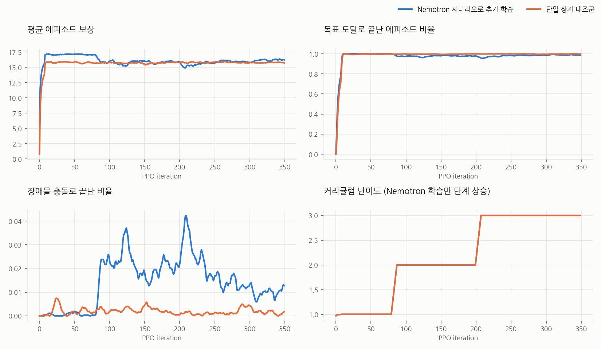
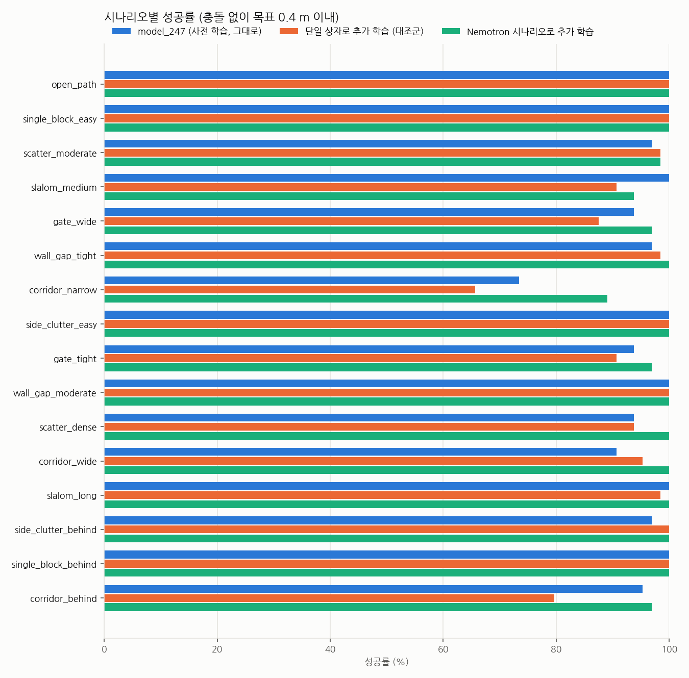
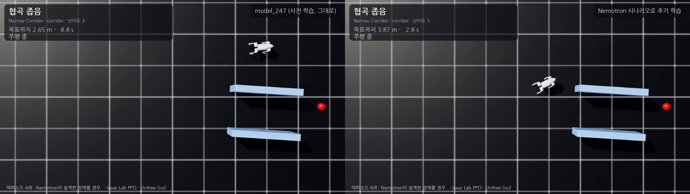

# 2단계: 장애물 시나리오 (Nemotron 설계) + 목표 도달·회피 PPO

기준일: 2026-10-29 · RTX 3090 · Isaac Lab 2.3 · Nemotron 3.5 Lightning 30B-A3B (Ollama)

## 1. 한 일

빈 평지에 장애물을 놓고, 로봇이 목표점까지 **부딪히지 않고** 가도록 PPO로 추가 학습했다.
어떤 장애물 배치를 얼마나 연습할지(시나리오)는 1단계와 같은 방식으로 Nemotron이 설계하고 검증기가 거른다.

```text
Nemotron → 검증기(수정 요청·guard) → configs/obstacles/go2_obstacles_v1.json (16개 시나리오)
        → PPO (512대, 350 iteration) → 시나리오별 평가 (같은 배치·같은 시드) → 영상
```

| 항목 | 값 |
|---|---|
| 정책 | 고수준 51 → 2 (목표 거리·방향, 전방 180° LiDAR 36개, 몸체 속도 → [전진, 회전]), 5 Hz |
| 보행 | 1단계 정책(`policies/stage1_walk/policy.pt`)을 고정해서 50 Hz로 사용 |
| 시작 가중치 | unitree_rl_lab `model_247` (단일 상자 1개로 학습된 통합 정책)에서 이어서 학습 |
| 장애물 | 환경마다 8칸: 기둥 3(0.3 m), 상자 3(0.6 m), 벽 조각 2(0.2×2.0 m), 높이 0.8 m, 회전 가능한 상자로 처리 |
| LiDAR | 장애물 상자와 광선의 교차를 해석적으로 계산 (이상적 센서, 학습 중 노이즈 ±0.02) |
| 충돌 | 로봇 중심이 장애물 표면에서 0.30 m 이내, 또는 발이 아닌 몸체 접촉 3 N 이상 |
| 보상 | 목표 방향 속도 3, 목표 도달 +40, 충돌 −80, 장애물 0.65 m 이내 근접 페널티, 시간 −0.05 등 (unitree_rl_lab `Sensor-Avoidance`와 같은 구성) |
| 커리큘럼 | 난이도 1만 → iteration 80부터 2 → 200부터 3 |

시나리오 유형과 배치 방법은 `nemotron_go2_rl/obstacles/layout.py`에 있다. 모든 배치는 시작점과 목표점이 장애물 표면에서 0.9 m 이상,
문·복도 폭은 0.9 m 이상이 되도록 거절 샘플링한다. 문(`gate`, `wall_gap`)과 복도(`corridor`)에는 통과 지점을 보상에서만 쓰는
유도 신호로 쓴다(정책 입력에는 없다).

## 2. Nemotron이 설계한 16개 시나리오

| id | 유형 | 난이도 | 가중치 | 목표 거리 (m) | 목표 방향 (°) | 위치(비율) | 옆 간격 (m) | 개수 | 틈/간격 (m) |
|---|---|---|---|---|---|---|---|---|---|
| open_path | open | 1 | 0.126 | 2.2–5.0 | -30–30 | 0.3–0.8 | 0.0–0.0 | 0–0 | 0.9–2.0 |
| single_block_easy | single_block | 1 | 0.094 | 2.5–4.5 | -30–30 | 0.4–0.6 | 0.0–0.5 | 1–1 | 0.9–2.0 |
| scatter_moderate | scatter | 2 | 0.075 | 3.0–5.0 | -30–30 | 0.3–0.8 | 0.5–1.5 | 2–5 | 0.9–2.0 |
| slalom_medium | slalom | 2 | 0.063 | 2.5–4.0 | -30–30 | 0.3–0.8 | 0.25–0.7 | 2–3 | 0.9–2.0 |
| gate_wide | gate | 2 | 0.063 | 2.5–4.5 | -30–30 | 0.4–0.6 | 0.0–0.8 | 2–2 | 0.9–1.3 |
| wall_gap_tight | wall_gap | 3 | 0.050 | 3.0–5.0 | -30–30 | 0.4–0.7 | 0.0–1.2 | 2–2 | 0.9–1.3 |
| corridor_narrow | corridor | 3 | 0.057 | 3.0–5.0 | -30–30 | 0.3–0.8 | 0.0–0.4 | 2–2 | 0.9–1.3 |
| side_clutter_easy | side_clutter | 1 | 0.082 | 2.5–4.5 | -30–30 | 0.3–0.7 | 1.0–1.8 | 1–3 | 0.9–2.0 |
| gate_tight | gate | 3 | 0.044 | 2.8–4.8 | -30–30 | 0.4–0.6 | 0.0–0.8 | 2–2 | 0.9–1.1 |
| wall_gap_moderate | wall_gap | 2 | 0.063 | 2.8–4.8 | -30–30 | 0.4–0.7 | 0.0–1.2 | 2–2 | 1.2–2.0 |
| scatter_dense | scatter | 3 | 0.057 | 3.5–5.0 | -30–30 | 0.3–0.8 | 0.2–1.5 | 4–5 | 0.9–2.0 |
| corridor_wide | corridor | 2 | 0.063 | 3.0–5.0 | -30–30 | 0.3–0.8 | 0.0–0.4 | 2–2 | 1.4–2.0 |
| slalom_long | slalom | 3 | 0.050 | 4.0–5.0 | -30–30 | 0.3–0.8 | 0.25–0.7 | 2–3 | 0.9–2.0 |
| side_clutter_behind | side_clutter | 3 | 0.044 | 2.5–4.5 | -170–-10 | 0.3–0.7 | 1.0–1.8 | 2–3 | 0.9–2.0 |
| single_block_behind | single_block | 3 | 0.038 | 2.5–4.0 | 10–170 | 0.4–0.6 | 0.0–0.5 | 1–1 | 0.9–2.0 |
| corridor_behind | corridor | 3 | 0.031 | 3.0–5.0 | -170–-10 | 0.4–0.7 | 0.0–0.4 | 2–2 | 0.9–1.3 |

생성 기록: 2번 시도(문제 2건 → 0건), 첫 시도 644 s · 수정 후 351 s, guard 개입 없음. 원본 `docs/nemotron_runs/obstacles_final.log`.

검토하면서 한 번 규칙을 보강했다. 처음 만든 카탈로그(`docs/nemotron_runs/obstacles_run1_without_corridor.json`)에는 복도 유형이 없었고, 기존 `model_247`을 먼저 평가했더니
이미 98.2 % 를 풀어서 평가가 너무 쉬웠다. 그래서 복도(`corridor`)와 밀집 흩어짐(`scatter`, 최대 5개) 유형을 추가하고 필수 요건으로 넣은 뒤 Nemotron에 다시 만들게 했다.
LiDAR 시야 밖인 뒤쪽 목표는 4개 시나리오가 다룬다. 다만 목표 방향이 옆(±90° 부근)인 시나리오는 거의 없고 앞쪽(−30~30°)과 뒤쪽 위주다.

## 3. 학습



- Nemotron 시나리오: 44분 8초. 마지막 iteration의 목표 도달 99.2 %, 장애물 충돌 0.85 %, 난이도 3.
- 단일 상자 대조군: 38분 17초. 사용한 분포는 `configs/obstacles/baseline_single_block.json` (원래 `Unified-Navigation`과 같은 상자 1개, 경로 위 80 % · 옆 20 %).
- 두 학습의 학습 분포가 달라서 학습 중 수치(목표 도달·충돌 비율)는 서로 비교하지 않는다. 비교는 아래 평가로 한다.

## 4. 평가

시나리오 16개 × 64대 = 1024 에피소드, 30초 제한, 시드 123. 모든 정책이 정확히 같은 장애물 배치와 목표를 받는다
(배치는 시드된 생성기로 만들고, 환경 `i`는 시나리오 `i % 16`을 맡는다). 성공은 충돌 없이 목표 0.4 m 이내 도달이다.
관측 노이즈는 끄고 로봇의 마찰·질량 무작위화는 학습과 같게 켰다.

| 정책 | 성공 | 충돌 | 시간 초과 |
|---|---|---|---|
| model_247 (사전 학습, 추가 학습 없음) | 95.7 % | 4.0 % | 0.3 % |
| 단일 상자로 추가 학습 (대조군) | 93.7 % | 6.3 % | 0.0 % |
| **Nemotron 시나리오로 추가 학습** | **98.2 %** | **0.8 %** | 1.0 % |

넘어짐은 세 정책 모두 0 %다. 성공률 합계 1024 에피소드 기준 표준오차는 약 0.6~0.8 %p라서 98.2 와 95.7의 차이(2.5 %p)는 크지 않고,
학습 seed가 하나뿐이라 seed 변동은 확인하지 못했다. 시나리오별 차이가 더 뚜렷하다.



| 시나리오 | model_247 | 대조군 | Nemotron |
|---|---|---|---|
| corridor_narrow (폭 0.9~1.3 m) | 73 % | 66 % | **89 %** (충돌 6 %) |
| corridor_behind | 95 % | 80 % | 97 % |
| gate_wide / gate_tight | 94 % / 94 % | 88 % / 91 % | 97 % / 97 % |
| scatter_dense | 94 % | 94 % | 100 % |
| slalom_medium | 100 % | 91 % | 94 % |

전체 표는 [results_stage2/results_table.md](results_stage2/results_table.md).

### 해석과 한계

- **대조군은 오히려 나빠졌다.** 상자 하나만 반복 학습하면 문·복도·지그재그에서 충돌이 늘었다(6.3 %). 경우의 수가 한 가지로 좁아지면 다른 배치에서 약해진다는 뜻으로 읽힌다.
- **Nemotron 시나리오 학습이 충돌을 4.0 → 0.8 %로 줄였다.** 가장 크게 좋아진 곳은 좁은 복도다.
- **회귀도 있다.** `slalom_medium`은 100 % → 94 %(시간 초과 5 %)로 나빠졌다. 지그재그가 난이도 2~3에 섞여 있고 좁은 틈을 우선 학습하면서 생긴 것으로 보이지만 원인을 따로 확인하지는 않았다.
- **통과하지 않고 돌아가도 성공이다.** 문·벽·복도 시나리오의 벽은 길이 2 m라서 로봇이 옆으로 돌아가도 목표에 도달하면 성공으로 센다.
  따라서 `corridor_*` 수치는 "복도를 통과한다"가 아니라 "복도 근처에서 부딪히지 않고 목표에 간다"의 척도다.
  영상에서도 사전 학습 정책이 복도를 돌아가는 장면이 있다.
- **막힘이 남아 있다.** 복도 시나리오 첫 에피소드(시드 11)에서 두 정책 모두 30초 동안 출발점에서 움직이지 못했다. 앞이 가로막힌 오목한 배치에서의 정체는
  기억 없는 반응형 정책의 한계로 보이며 이번 학습으로 풀리지 않았다.
- 보행은 1단계 정책으로 바꿔 끼웠고(`model_247`은 원래 다른 보행 정책으로 학습됨), 센서는 이상적인 광선이다. 시뮬레이션 평가이며 MuJoCo·실기는 하지 않았다.
- 시나리오 평가는 Nemotron의 시나리오 자체다. 대조군은 그 분포를 보지 못한 상태에서 평가받으므로 유리한 비교가 아니다. 사람이 직접 짠 시나리오 세트와는 비교하지 않았다.

## 5. 영상

| 파일 | 내용 |
|---|---|
| [media/stage2_tour_zeroshot_vs_nemotron.mp4](media/stage2_tour_zeroshot_vs_nemotron.mp4) | 16개 시나리오를 한 번씩, 왼쪽 사전 학습 model_247 · 오른쪽 Nemotron 추가 학습. 위에서 본 화면. 두 정책 모두 한 번씩은 전부 도달해서 차이가 보이지 않는다 |
| [media/stage2_corridor_zeroshot_vs_nemotron.mp4](media/stage2_corridor_zeroshot_vs_nemotron.mp4) | `corridor_narrow` 8 에피소드. 사전 학습은 충돌·몸체 접촉 2회, 시간 초과 1회, Nemotron은 충돌 1회, 시간 초과 1회 (같은 배치) |



한 정책당 8 에피소드뿐이라 영상은 설명용이다. 성공률 비교는 4절의 1024 에피소드 평가를 기준으로 한다.

## 6. 재현

```bash
python scripts/generate_obstacle_cases.py                         # Nemotron, ~10-15 min
U=<unitree_rl_lab>/logs/rsl_rl/unitree_go2_unified_navigation/2026-10-12_02-21-01_unified_full_circle_v1/model_247.pt
python scripts/train_avoid.py --headless --max_iterations 350 --run_name nemotron_obstacles_v1 --resume_path $U --seed 42
python scripts/train_avoid.py --headless --task Nemotron-Go2-Obstacles-Control --max_iterations 350 --run_name control_single_box_v1 --resume_path $U --seed 42
python scripts/evaluate_avoid.py --headless --per_case 64 --policy "model_247=$U" --policy "control=<run>/model_349.pt" --policy "nemotron=<run>/model_349.pt" --out outputs/eval/stage2.json
python scripts/record_avoid.py --headless --policy "label=<ckpt>" --episodes 16 --out outputs/videos/avoid.mp4
python scripts/report_avoid.py --eval outputs/eval/stage2.json --run "label=<run dir>" --out docs/results_stage2
```

결과 정책: `policies/stage2_obstacles/` (TorchScript, ONNX, 학습에 쓴 시나리오, SHA256SUMS). 이 정책은 보행 정책 `policies/stage1_walk/policy.pt`와 함께 써야 한다.
체크포인트 `model_349.pt` SHA-256 `cb85ae864a47aff81417857cae4ee5aae477be27e436a3769645829dd23fb0b7`.
`model_247`은 이 저장소에 포함하지 않는다(unitree_rl_lab 연구 로그, SHA-256 `7108b05f…bf4082`).
